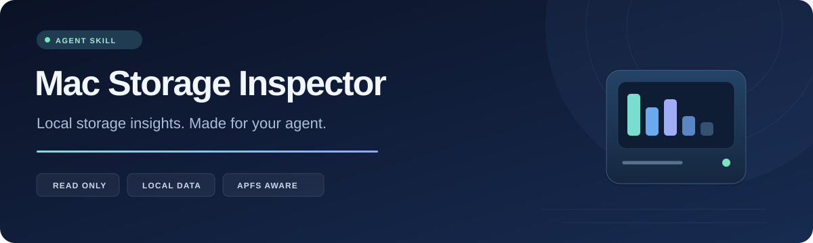

<p align="center">
  
</p>

<p align="center">
  <strong>让 Agent 看清 Mac 的存储占用，再为这台电脑生成合适的调查脚本。</strong><br />
  A reusable macOS storage inspection skill, with evidence and customization kept on your Mac.
</p>

<p align="center">
  
  
  
  <a href="https://github.com/jnlk-cn/mac-storage-inspector/stargazers"></a>
</p>

<p align="center">
  <a href="#quick-start">快速开始</a> ·
  <a href="#features">功能</a> ·
  <a href="#customization">本机定制</a> ·
  <a href="#privacy">隐私边界</a> ·
  <a href="#star-history">Star History</a>
</p>

---

Mac Storage Inspector 是一个面向 Agent 的存储空间检查 Skill：核对 APFS 卷占用，定位大目录，保留权限和云端目录的扫描缺口，并根据当前电脑的实际用途生成本地定制脚本。

共享仓库提供通用工具和空白模板。真实路径、扫描报告与定制脚本保存在使用者自己的电脑上。

## Features

<table>
  <tr>
    <td width="33%"><strong>🧭 APFS 占用核对</strong><br />动态识别启动容器及后端存储，分开查看容器可用空间、卷占用和文件分配块。</td>
    <td width="33%"><strong>🔎 有范围的调查</strong><br />目录扫描有时间预算；保留超时和访问缺口，支持按指定路径继续检查。</td>
    <td width="33%"><strong>📊 本地可视报告</strong><br />HTML 报告支持筛选和路径下钻，同时保留 JSON 摘要与原始元数据证据。</td>
  </tr>
  <tr>
    <td><strong>🛠️ 按电脑定制</strong><br />Agent 根据实际证据配置项目根目录、保护路径和日志目录，再验证专属调查脚本。</td>
    <td><strong>🔒 只读与本地保存</strong><br />不读取被检查文件的正文，不上传检查报告；真实配置位于共享 Skill 之外。</td>
    <td><strong>🧩 源码随 Skill 分发</strong><br />使用 Python 标准库与 C 扫描器，在目标 Mac 上编译，无需安装额外 Python 包。</td>
  </tr>
</table>

## Quick start

### 1. 安装 Skill

需要 **Python 3.9+**、现代 macOS 的 **APFS 启动 Data 卷**，以及已安装的 **Apple Command Line Tools**。

```bash
SKILL_DIR="${CODEX_HOME:-$HOME/.codex}/skills/mac-storage-inspector"
git clone https://github.com/jnlk-cn/mac-storage-inspector.git "$SKILL_DIR"
```

如果目标目录已存在，请先检查已有内容或选择新目录。其他 Agent 可以使用各自的 skills 目录，或直接读取 [SKILL.md](SKILL.md)。

### 2. 交给 Agent

```text
使用 $mac-storage-inspector 检查这台 Mac 的存储空间，
根据当前检查结果生成本地定制调查脚本，并核对扫描覆盖与报告。
```

### 3. 也可以手动检查

```bash
python3 "$SKILL_DIR/scripts/storage_inspector.py" doctor
python3 "$SKILL_DIR/scripts/storage_inspector.py" build
python3 "$SKILL_DIR/scripts/storage_inspector.py" collect --path "$HOME" --seconds 30 --budget 120
python3 "$SKILL_DIR/scripts/storage_inspector.py" query --limit 15
```

`--seconds` 限制单个扫描任务，`--budget` 限制本次目录遍历。环境检查、编译和卷信息查询另有超时，不计入遍历预算。

## How it works

**预检 → 元数据扫描 → 证据分析 → 本机定制 → 执行复核**

| 阶段 | 做什么 | 得到什么 |
| --- | --- | --- |
| `doctor` | 查询当前系统与启动 APFS 容器 | 环境和卷信息 |
| `collect` | 在限定范围与时间内读取元数据 | 大目录、候选项、访问错误与覆盖范围 |
| `query` | 按路径或类别查询已有证据 | 无需重复整盘扫描的摘要 |
| `make-local` | 在共享 Skill 之外生成本地案例 | 空白配置和调查脚本模板 |
| `plan` / `scan` | 检查定制目标，再执行只读调查 | 适合当前电脑的检查结果 |

报告默认保存到当前用户的 `~/Library/Application Support/MacStorageInspector/`，也可以通过 `--state-dir` 选择其他私有目录。

```text
MacStorageInspector/
├── cache/                     # 在当前 Mac 编译的扫描器
├── reports/<timestamp>/
│   ├── report.html            # 可筛选、可下钻的本地报告
│   ├── analysis.json          # 结构化结果
│   ├── summary.txt            # 简要说明
│   └── raw/                   # 原始元数据证据
└── latest-storage.json
```

## Customization

每台电脑的项目、应用和保留需求不同。Agent 应先读取当前证据，再完成定制；共享模板中的路径列表默认全部为空。

```bash
# 选择一个尚不存在、位于 Skill 和项目仓库之外的本地案例目录。
LOCAL_CASE="$HOME/Library/Application Support/MacStorageInspector/local/example"
python3 "$SKILL_DIR/scripts/storage_inspector.py" make-local --destination "$LOCAL_CASE"
```

随后由 Agent 根据真实目录填写 `profile.json` 中的 `targets`、`project_roots`、`protected_paths` 和 `log_roots`，并按问题补充范围明确的只读检查。

```bash
python3 "$LOCAL_CASE/investigate_local.py" plan --skill-dir "$SKILL_DIR"
python3 "$LOCAL_CASE/investigate_local.py" scan --skill-dir "$SKILL_DIR" --seconds 20 --budget 120
```

保护路径优先于其他分类。没有配置目标时，定制脚本会拒绝扫描，避免把空模板当作已完成的调查。

→ [查看定制脚本工作流](references/customization.md)

## Privacy

| 共享仓库中 | 只保存在使用者本机 |
| --- | --- |
| 通用源码、Skill 指令、空白模板 | 实际用户名、个人目录和本机配置 |
| 通用文档与品牌素材 | 定制调查脚本、历史清理脚本 |
| 临时测试数据的构造代码 | 真实检查报告、截图、原始证据和编译缓存 |

- 扫描器只读取被检查文件的元数据，不跟随符号链接，不跨文件系统边界。
- 云端 DATALESS 目录、权限拒绝与超时都会保留为覆盖缺口，不能当成空目录。
- 默认以普通用户运行。确需管理员补查时，遵循 [SKILL.md](SKILL.md) 中的权限流程；不保存管理员密码，也不安装特权后台服务。
- 检查工具没有清理命令。发现候选目录不代表获得删除授权，目录占用也不是保证可回收量。

APFS 克隆共享块、快照、元数据和文件变化会影响统计。分配块与逻辑大小分列；同大小文件仅是重复候选，未经内容验证。

README 中的徽章和 Star 图由公共服务加载，仅涉及已公开的仓库元数据，不使用 GitHub 访问令牌，也不接触本机扫描报告。

## Compatibility & verification

| 项目 | 当前范围 |
| --- | --- |
| macOS | 现代 macOS 的 APFS 启动 Data 卷 |
| Python | 3.9+ 语法兼容；实际运行验证基于 Python 3.14 |
| Apple Silicon | 原生扫描器编译、运行及小范围实扫已验证 |
| Intel | x86_64 交叉编译通过；尚未在 Intel 真机运行 |
| HFS+ / 外接盘 | 需要 Agent 另选适合的只读检查方法 |

```bash
python3 "$SKILL_DIR/scripts/test_storage_inspector.py"
```

现有 **21 项行为测试**覆盖硬链接、稀疏文件、符号链接、权限拒绝、动态磁盘识别、超时、取消保存、配置保护和报告转义。测试使用临时目录，不需要 sudo。

## Star History

如果这个 Skill 对你有帮助，欢迎点亮一颗 Star。下图展示此仓库的真实 Star 变化，由服务按缓存策略更新。

<p align="center">
  <a href="https://www.star-history.com/?repos=jnlk-cn%2Fmac-storage-inspector&amp;type=date">
    <picture>
      <source media="(prefers-color-scheme: dark)" srcset="https://api.star-history.com/chart?repos=jnlk-cn/mac-storage-inspector&amp;type=date&amp;theme=dark" />
      <source media="(prefers-color-scheme: light)" srcset="https://api.star-history.com/chart?repos=jnlk-cn/mac-storage-inspector&amp;type=date" />
      
    </picture>
  </a>
</p>

新仓库尚无 Star 时，曲线可能暂时没有数据点；不会使用示例或模拟增长数据替代真实记录。

---

<p align="center">
  <a href="SKILL.md">Skill 指令</a> ·
  <a href="references/customization.md">定制工作流</a> ·
  <a href="https://github.com/jnlk-cn/mac-storage-inspector/issues">反馈问题</a>
</p>
